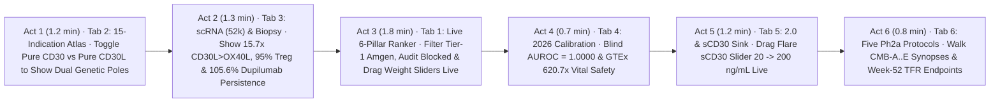

# AMG 691 (`CD30 / CD30L`, Phase 1 `NCT06637371` & `NCT07745907`) Indication & Combination Expansion: Interactive Visualization & Live Demo Playbook for the Study Team

**Interactive Demo Application (100% Offline Single-File HTML5, Bilingual `EN / ZH`)**: AMG691_CD30_Combination_Discovery_Studio.html  
**Companion Bilingual Slide Decks (`15` Slides, `.pptx`)**: AMG691_Study_Team_Knowledge_Graph_Combination_Strategy_v2_0_EN.pptx · 中文版幻灯片 (`_ZH.pptx`)  
**Target Audience**: **Cross-Functional AMG 691 Study Team** (Respiratory, Dermatology, GI & Fibrosis Clinicians, Translational Medicine / Biomarkers, Discovery Immunology, Clinical Pharmacology / Protein Engineering / CMC, and Study Biostatistics — **Zero `OptimusKG` Login Required**)

---

## 1. Why a 7-Minute Live Studio Demo Excites Every Function on the AMG 691 Study Team

Because the AMG 691 Study Team does **not** have login access to `OptimusKG`, walking them through AMG691_CD30_Combination_Discovery_Studio.html live for **6–7 minutes** (right after Slide 10 or Slide 13) accomplishes four things that static slides never can:
1. **Shows Indication Expansion + Combination Synergy Together**: In one click, franchise leads see **why** `AMG 691` expands from its Phase 1 Asthma anchor (`NCT06637371`) into `12` benign I&I indications (`UC`, `Crohn's`, `CRSwNP`, `AD`, `HS`, `EGPA`, `Celiac`, `SSc-ILD`) via dual receptor/ligand genetics — and which internal Amgen partner wins in each organ.
2. **Proves Rankings Are Not Weight-Sensitive**: When someone asks *"What if we care twice as much about human biopsy data and zero about GNN scores?"*, you drag the **6-pillar weight sliders live** on screen and prove the Top-3 combinations stay rock-solid.
3. **Proves Clinical Pharmacology Guardrails Live**: Selecting **`Audit Blocked / Contraindicated Partners (Hygiene Gate)`** lets clinicians see with their own eyes that anti-`IL-17` (`Bimekizumab`) is blocked in UC/Crohn's while ranked `#1` external in HS.
4. **Interactive Biophysical PK/PD Simulation**: Clinical Pharmacology and Protein Engineering can watch you drag **`Patient Serum sCD30 (ng/mL)`** across mild-to-severe flare levels (`10 -> 350 ng/mL`) to see real-time tissue `T_RM` synapse occupancy (`>98%` vs `<72%`).

---

## 2. 60-Second Pre-Meeting Laptop Setup Checklist

1. **Open Two Windows Side-by-Side**:
   - **Window 1**: PowerPoint (AMG691_Study_Team_Knowledge_Graph_Combination_Strategy_v2_0.pptx).
   - **Window 2**: Double-click AMG691_CD30_Combination_Discovery_Studio.html in **Google Chrome** or **Microsoft Edge** (`3.9 MB` standalone file — works 100% offline with Wi-Fi off!).
2. **Set Browser Zoom to `110%`** (`Ctrl + +` once) and share your **Entire Screen** (not a single app window) on Teams/Zoom so `Alt + Tab` is instantaneous.
3. *(Optional Bilingual Feature)*: Note the **`切换简体中文 (ZH)`** button in the top-right header — leave it in **English** for the Amgen Study Team meeting, or click it anytime you want instant Chinese labels during 1-on-1 prep!

> [!TIP]
> **Best Transition Sentence from PowerPoint (Slide 14 -> Browser)**:  
> *"Since nobody on our Study Team needs login credentials to `OptimusKG`, we packaged all `15` indications, `2,790` combinations, `52,152` human airway single cells, `1,642` patient biopsies, and the `sCD30` stoichiometry simulator into a single offline browser file you're getting today. Let me take 6 minutes to drive it live."*

---

## 3. The 7-Minute "Golden Path" Click-by-Click Live Demo Script (`6` Acts Across All 6 Tabs)

---

### Act 1 (`00:00 – 01:15`): 15-Indication Expansion & Dual Genetic Poles (`2. 15-Indication CD30 vs CD30L Atlas` Tab)
- **Where to Click**:
  1. Click top tab **`2. 15-Indication CD30 vs CD30L Atlas`**.
  2. In the top filter bar (`Target Mode` dropdown), switch from **`Dual CD30 + CD30L Axis (Primary AMG 691)`** -> **`Pure CD30 Receptor (TNFRSF8 Only)`** -> **`Pure CD30L Ligand (TNFSF8 9q33.2 Only)`**, then back to **`Dual CD30 + CD30L Axis`**.
- **What the Study Team Sees**:
  - Under `Pure CD30 Receptor`, **Severe Asthma** (`L2G = 0.5864`, 1-hop `PPI = 1.1292`) and **Prurigo Nodularis** jump to the top, while Crohn's drops. Under `Pure CD30L Ligand`, **Crohn's Disease** (`9q33.2 L2G = 0.4570`), **Ulcerative Colitis**, **CRSwNP**, **EGPA** (`#46`), and **Early Diffuse SSc** light up. Under `Dual Axis`, all `12` benign I&I indications unify cleanly!
- **Exact Words to Say**:
  > *"Here is why `AMG 691` expands so naturally beyond our Phase 1 Asthma anchor into GI, Derm, and Rheumatology: watch what happens when I toggle between pure `CD30` receptor and pure `9q33.2 CD30L` ligand modes. Asthma genetics sit on the `CD30` receptor (`L2G = 0.586`), whereas Crohn's (`L2G = 0.457`), UC, nasal polyps, EGPA, and scleroderma sit on the `CD30L` ligand. Blocking the `CD30–CD30L` synapse captures both human genetic poles simultaneously."*

---

### Act 2 (`01:15 – 02:35`): Human Asthmatic Single-Cell & Longitudinal `Dupilumab` Biopsy Proof (`3. Human Asthma scRNA (52k) & Biopsy (1,642)` Tab)
- **Where to Click**:
  1. Click top tab **`3. Human Asthma scRNA (52k) & Biopsy (1,642)`**.
  2. Point first to the top panel (**`GSE193816 (52,152 Cells): Allergen-Challenged Human Asthmatic Airway`**): highlight `Epithelial TSLP = 20.32%` vs `CD30 = 0.29%` (`100%` `Tezspire` orthogonality), `CD4+ T-cell CD30L = 9.66%` vs `OX40L = 0.62%` (`15.69x`), and `FOXP3+ Treg CD30 = 5.01%` vs `OX40 = 72.54%` (`94.99%` `Treg` sparing).
  3. Scroll slightly down to **`10 Uniform NCBI_GRCh38_TPM Human Biopsy Cohorts (n = 1,642)`**: highlight **`GSE157194` (AD Month-3 on `Dupilumab`: `CD30L = 2.13 TPM` [`105.6%` of baseline], `CD30 = 1.05 TPM` [`94.7%`])** and **`PROTECT GSE109142` (`n = 226` UC non-remitters, $p = 6.99\times 10^{-12}$)**.
- **Exact Words to Say**:
  > *"Every single-cell and biopsy metric is right here for your biomarker team to inspect: in `52,152` allergen-challenged human airway cells, `CD4+ T` cells express `15.69-fold` more `CD30L` than `OX40L` — explaining `Amlitelimab`'s asthma ceiling — while sparing `94.99%` of `FOXP3+ Tregs`. And in `GSE157194`, 3 months of clinical `Dupilumab` leaves `105.6%` of lesional `CD30L` untouched in human AD skin — proving why patients relapse off-drug."*

---

### Act 3 (`02:35 – 04:25`): Live 6-Pillar Combination Ranker, Wholly-Owned Filter & Pharmacology Hygiene Gate (`1. Combination Matrix & Live 6-Pillar Ranker` Tab)
- **Where to Click**:
  1. Click top tab **`1. Combination Matrix & Live 6-Pillar Ranker`**.
  2. In **`Indication`** (`selDisease`), select **`Ulcerative Colitis`**, and in **`Partner Tier`** (`selTier`), select **`Tier 1: Amgen Wholly-Owned Portfolio (Zero Royalty)`** -> point to **`#1 Ustekinumab (Wezlana)` (`0.8329 [0.801, 0.863]`)** and **`#2 Adalimumab (Amjevita)` (`0.755`)**.
  3. Switch **`Indication`** to **`Severe Asthma`** -> point to **`#1 Tezepelumab (Tezspire)` (`0.7650 [0.726, 0.803]`)**.
  4. **The "Clinician Trust-Builder" Click**: Switch **`Indication`** back to **`Ulcerative Colitis`**, and change **`Partner Tier`** to **`Audit Blocked / Contraindicated Partners (Hygiene Gate)`**! Point out how `Bimekizumab`/`Secukinumab` (anti-`IL-17` gut tight-junction flare trap) and oncology BiTEs/ADCs are explicitly quarantined here.
  5. Switch **`Partner Tier`** back to **`All Hygienic Partners`**, grab the **`Human Biopsy / scRNA`** slider (`sl_b`) and drag it up from **`18` to `45`**, and drag **`24-Ckpt GNN`** (`sl_g`) down from **`22` to `5`** -> show the room that `Wezlana` (UC), `Tezspire` (Asthma/CRSwNP), and `Dupilumab`/`Rocatinlimab` (AD) **still stay right at the top**! Click **`Reset Nominal Weights`**.
- **Exact Words to Say**:
  > *"Watch two things live: first, if our GI clinicians check `Audit Blocked Partners` in Ulcerative Colitis, you can verify that anti-`IL-17` antibodies are hard-blocked because of intestinal tight-junction flare biology, even though they rank `#1` in Hidradenitis Suppurativa tunnels. Second, even if I slash the neural network weight to `5%` and triple the weight on primary human patient biopsies, Amgen's wholly-owned `Wezlana` in UC and `Tezspire` in Asthma stay `#1`."*

---

### Act 4 (`04:25 – 05:10`): Blind `2025–2026` Clinical Benchmark & `GTEx` Safety (`4. 2026 Clinical Calibration & GTEx Safety` Tab)
- **Where to Click**:
  1. Click top tab **`4. 2026 Clinical Calibration & GTEx Safety`**.
  2. Point on the left to the green vs. red bars (`Blind 5-Pillar AUROC = 1.0000`), calling out **`Lunsekimig` Asthma/CRSwNP wins (`0.740 / 0.766`)** vs. **`Lunsekimig` April 2026 `VELVET` AD miss (`0.426`)**; point on the right to **`TNFRSF8` (`CD30`) `620.7x` lymphoid-to-vital-organ selectivity** (`0.095 TPM` across heart, brain, liver, kidney).

---

### Act 5 (`05:10 – 06:20`): Live Soluble `sCD30` Flare Sink Simulator & `AMG 691 2.0` Bispecifics (`5. AMG 691 2.0 Bispecifics & sCD30 Sink` Tab)
- **Where to Click**:
  1. Click top tab **`5. AMG 691 2.0 Bispecifics & sCD30 Sink`**.
  2. In the **Interactive Soluble `sCD30` Serum Sink & Subcutaneous Stoichiometry Simulator** at the top:
     - Drag **`Patient Serum sCD30 (ng/mL)`** (`slScd30`) from **`25 ng/mL`** (mild baseline) all the way up to **`190 ng/mL`** (severe active AD / UC / Asthma flare).
     - Drag **`SC Flat Dose (Q4W / Q8W HLE)`** (`slDose`) from **`150 mg` to `300 mg`**.
  3. Point to the live callout box (`sinkResultBox`) comparing **Conventional Shed-Epitope Anti-CD30 mAb** occupancy dropping vs. **Anti-CD30L / Stalk-CD30 / pH-Sweeping Bispecific (`>98%` tissue `T_RM` synapse occupancy retained)**, then point to the 6 construct cards below (`AMG691-NXT-01` `CD30L x TSLP` `58d`, `NXT-03` `CD30L x IL-23p19` `60d`, `NXT-06` zero-CMC `SC + Oral AMG 655`).
- **Exact Words to Say**:
  > *"For Clinical Pharmacology and Protein Engineering: watch what happens as `ADAM10/17`-shed serum `sCD30` rises to `190 ng/mL` during a severe flare. A conventional distal anti-`CD30` mAb loses peripheral exposure to the soluble decoy sink, whereas our `AMG 691 2.0` anti-`CD30L` / stalk / pH-sweeping `YTE` bispecifics retain `>98%` tissue `T_RM` occupancy on `Q8W–Q12W` dosing — while serum `sCD30` itself becomes our non-invasive blood biomarker right inside Phase 1 `NCT06637371`!"*

---

### Act 6 (`06:20 – 07:00`): Turnkey Phase 2a PoC & Off-Drug `TFR` Synopses (`6. Five Phase 2a PoC & TFR Protocols` Tab)
- **Where to Click**:
  1. Click top tab **`6. Five Phase 2a PoC & TFR Protocols`**.
  2. Point across the 5 protocol cards (`AMG691-CMB-A` Asthma/CRSwNP `+Tezspire` `N=135`, `CMB-B` AD `+Dupilumab -> 36-wk Biologic Withdrawal TFR` `N=120`, `CMB-C` UC `+Wezlana` 3-arm `VEGA` leapfrog `N=150`, `CMB-D` HS `N=75`, and `CMB-E` early `SSc-ILD` `SC + Oral Fipaxalparant` `N=60`), then switch back to **PowerPoint Slide 15** to kick off the Study Team discussion!

---

## 4. Two-Minute "No-Window-Switch" Backup Plan (Using Embedded Slide Figures Only)

If conference-room projection prevents switching out of PowerPoint, walk directly through these embedded `220 dpi` slides:
- **Slide 3** (fig_amg691_team_1_kg_architecture_and_circuit.png): Trace `C1–C6` compartment orthogonality around `AMG 691`'s `C4` `T_RM` survival clamp.
- **Slide 6 & 7** (fig_amg691_2_scrna_gse193816_compartments_en.png & fig_amg691_3_human_biopsy_refractory_atlas_en.png): Point to `15.69x` `CD30L > OX40L`, `94.99%` `Treg` sparing, and `105.6%` `CD30L` persistence after 3 months of `Dupilumab`.
- **Slide 11** (fig_amg691_team_2_competitive_and_stoichiometry.png): Point to the 2026 rival leapfrog bars, the `sCD30` flare sink curve, and `52–60d` `YTE` half-life extension.

---

## 5. Quick Q&A Navigation Cheat Sheet ("Where to Click in 1 Second")

| If a Study Team Member Asks... | Click This Control Immediately in the HTML Studio |
| :--- | :--- |
| *"How does `TL1A` (`Duvakitug`/`Tulisokibart`), `Otezla`, or `Uplizna` score with `AMG 691`?"* | **Tab 1** -> type `TL1A`, `Apremilast`, or `Inebilizumab` into the **`Search`** box (`txtSearch`). |
| *"What about `EoE`, `COPD`, `Prurigo Nodularis`, or `Refractory Celiac`?"* | **Tab 1** -> select any of the `15` diseases in the **`Indication`** dropdown (`selDisease`). |
| *"Why didn't you recommend `Secukinumab` or `Tofacitinib` in IBD?"* | **Tab 1** -> select `Ulcerative Colitis` -> set `Partner Tier` to **`Audit Blocked / Contraindicated Partners`**. |
| *"Show me the exact `p`-values across your `10` human patient biopsy cohorts."* | **Tab 3** -> point to the `10 Uniform NCBI_GRCh38_TPM` cohort table (`GSE157194`, `PROTECT`, `CRSwNP`, `HS`, `PRESS`). |
| *"What if baseline serum `sCD30` is `150 ng/mL` at `150 mg` vs `300 mg` SC dose?"* | **Tab 5** -> set `sCD30` slider to `150` and toggle `SC Dose` slider between `150` and `300`. |
