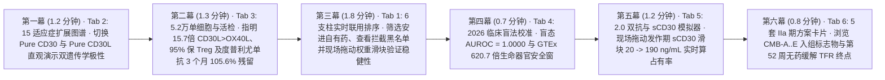

# AMG 691（`CD30 / CD30L`，I 期 `NCT06637371` & `NCT07745907`）适应症扩展与联合用药发现：面向临床项目组（Study Team）的可视化现场演示（Live Demo）实战手册

**单文件离线交互式演示系统（100% 免服务器 HTML5，自带中英一键切换）**：AMG691_CD30_Combination_Discovery_Studio.html  
**配套中英双语可编辑幻灯片（`15` 页 `.pptx`）**：AMG691_Study_Team_Knowledge_Graph_Combination_Strategy_v2_0_ZH.pptx · 英文版幻灯片 (`_EN.pptx`)  
**汇报对象**：**AMG 691 跨职能临床研究项目组（Study Team）**（呼吸、皮肤、消化与纤维化临床研发负责人/医学总监、转化医学与生物标志物团队、免疫发现团队、临床药理/蛋白工程/CMC 团队、项目生物统计师 —— **全员无需知识图谱后台账号**）

---

## 1. 为什么用这个交互式可视化平台做 7 分钟 Live Demo 能瞬间点燃全场？

在向 AMG 691 Study Team 汇报时，切入 AMG691_CD30_Combination_Discovery_Studio.html 进行 **6–7 分钟现场实操演示**，能一次性完美跑通**“15 个适应症扩展（Indication Expansion）”与“62 个搭档正交联合用药/双抗工程（Combination & 2.0 Bispecifics）”**完整闭环，当场打消四大跨职能顾虑：
1. **一键直观展现“适应症为何能从哮喘扩展到消化、皮肤与硬皮病”**：现场切换 `Pure CD30` 与 `Pure CD30L` 模式，项目组肉眼可见哮喘遗传学落在受体 `CD30` 上，而克罗恩病、溃结、鼻息肉、EGPA 与硬皮病落在配体 `9q33.2 CD30L` 上——双轴阻断天然打通 `12` 个良性自免适应症！
2. **现场拖动滑块打破“人为调权重”质疑**：当统计师或医学总监问*“如果把神经网络权重砍掉、把人类活检权重翻倍，排名会变吗？”*时，你当场拖动 **6 大支柱权重滑块**，证明安进自有 `Wezlana`（UC）和 `Tezspire`（哮喘/鼻息肉）依然稳居榜首！
3. **现场验证临床药理安全红线**：一键切到 **`Audit Blocked / Contraindicated Partners`**，让消化科医生亲眼看到抗 `IL-17`（比美吉珠单抗）在溃结/克罗恩病中被系统自动拦截，而在化脓性汗腺炎中排外部第 1。
4. **实时模拟患者发作期可溶性 `sCD30` 药代诱饵池**：现场拖动患者血清 `sCD30` 浓度滑块（`10 -> 350 ng/mL`）与皮下给药剂量（`70 -> 600 mg`），实时计算组织 `T_RM` 突触占有率！

---

## 2. 会前 60 秒电脑准备清单（Pre-Flight Setup）

1. **提前并排打开两个窗口**：
   - **窗口 1**：PowerPoint（AMG691_Study_Team_Knowledge_Graph_Combination_Strategy_v2_0.pptx）。
   - **窗口 2**：用 **Chrome** 或 **Edge** 双击打开 AMG691_CD30_Combination_Discovery_Studio.html（仅 `3.9 MB` 单文件，断网离线秒开）。
2. **浏览器缩放设为 `110%`**（`Ctrl + +` 一次），线上会议务必选择**“共享整个屏幕（Entire Screen）”**以便 `Alt + Tab` 秒速切换。
3. **贴心双语彩蛋**：页面右上角内置了 **`切换简体中文 (ZH)`** 按钮！你在自己备课或与华人同事讨论时可一键切为全中文界面；正式向英文 Study Team 演示时保持默认英文界面即可。

> [!TIP]
> **从 PPT 切入 Live Demo 的最佳过渡语（建议在讲完 Slide 14 工具包页面后切入）**：  
> *"Since nobody on our Study Team needs login credentials to `OptimusKG`, we packaged all `15` indications, `2,790` combinations, `52,152` human airway single cells, `1,642` patient biopsies, and the `sCD30` PK/PD sink simulator into this single offline HTML file you're receiving today. Let me take 6 minutes to drive it live."*

---

## 3. 7 分钟“黄金动线”逐次点击演示剧本（横跨全部 `6` 大交互标签页）

---

### 第一幕（`00:00 – 01:15`）：15 适应症扩展与“受体 vs 配体”双遗传学极性（点击 `2. 15-Indication CD30 vs CD30L Atlas`）
- **鼠标点击动作**：
  1. 点击顶部第 2 个标签页 **`2. 15-Indication CD30 vs CD30L Atlas`**。
  2. 在上方筛选栏 **`Target Mode`** 下拉框中，依次从 **`Dual CD30 + CD30L Axis`** 切换到 **`Pure CD30 Receptor (TNFRSF8 Only)`**，再切到 **`Pure CD30L Ligand (TNFSF8 9q33.2 Only)`**，最后切回 **`Dual CD30 + CD30L Axis`**。
- **画面实时变化**：
  - 选纯受体 `CD30` 时，**重度哮喘**（`L2G = 0.5864`）和**结节性痒疹 PN** 高亮领跑；切到纯配体 `CD30L` 时，**克罗恩病**（`9q33.2 L2G = 0.4570`）、**溃疡性结肠炎 UC**、**鼻息肉 CRSwNP**、**EGPA 血管炎**与**硬皮病 SSc** 瞬间跃升；切回双轴模式时，`12` 个良性自免适应症全面贯通！
- **英文直念金句**：
  > *"Watch what happens when I switch Target Mode from pure `CD30` receptor to pure `9q33.2 CD30L` ligand: Asthma genetics sit on the `CD30` receptor (`L2G = 0.586`), whereas Crohn's (`L2G = 0.457`), UC, CRSwNP, EGPA, and scleroderma sit on the `CD30L` ligand. Blocking the complete `CD30–CD30L` synapse expands `AMG 691` cleanly across all four I&I franchises."*

---

### 第二幕（`01:15 – 02:35`）：5.2 万人类气道单细胞与度普利尤单抗纵向活检铁证（点击 `3. Human Asthma scRNA (52k) & Biopsy (1,642)`）
- **鼠标点击动作**：
  1. 点击顶部第 3 个标签页 **`3. Human Asthma scRNA (52k) & Biopsy (1,642)`**。
  2. 鼠标指向半屏的 **`GSE193816 (52,152 Cells)`**：依次点出支气管上皮 `TSLP 20.32%` vs `CD30 0.29%`（与 `Tezspire` 100% 细胞正交）、气道 `CD4+ T` 细胞 `CD30L 9.66%` vs `OX40L 0.62%`（**`15.69 倍`**，定量解释 `Amlitelimab` 哮喘折戟）、以及调节性 `FOXP3+ Treg` 上 `CD30` 仅 `5.01%` vs `OX40 72.54%`（**`94.99%` 保 `Treg`**）。
  3. 向下微滚至 **`10 Uniform NCBI_GRCh38_TPM Human Biopsy Cohorts (n = 1,642)`**：高亮指明 **`GSE157194`**（人类 AD 接受度普利尤单抗临床治疗 3 个月后，皮损 `CD30L` 仍高达基线的 **`105.6%`**，`CD30` 仍达 **`94.7%`**）以及 **`PROTECT` 初治不缓解 UC**（$p = 6.99\times 10^{-12}$）。

---

### 第三幕（`02:35 – 04:25`）：6 支柱实时联用排序、安进自有管线过滤与安全拦截审计（点击 `1. Combination Matrix & Live 6-Pillar Ranker`）
- **鼠标点击动作**：
  1. 点击顶部第 1 个标签页 **`1. Combination Matrix & Live 6-Pillar Ranker`**。
  2. 在 **`Indication`** 下拉框选 **`Ulcerative Colitis`**（溃结），在 **`Partner Tier`** 下拉框选 **`Tier 1: Amgen Wholly-Owned Portfolio (Zero Royalty)`** —— 指明榜首 **`#1 Ustekinumab (Wezlana)`（`0.8329 [0.801, 0.863]`）**，用 100% 安进自有品种弯道超车默沙东 `MK-8690` 单药！
  3. 把 **`Indication`** 切到 **`Severe Asthma`** —— 指明榜首 **`#1 Tezepelumab (Tezspire)`（`0.7650`）**；切到 **`Refractory Celiac Disease`** —— 指明 **`#1 Ordesekimab (AMG 714)`（`0.6922`）**。
  4. **征服临床医生的杀手锏操作**：把 **`Indication`** 切回 **`Ulcerative Colitis`**，将 **`Partner Tier`** 切换为 **`Audit Blocked / Contraindicated Partners (Hygiene Gate)`**！向全场展示抗 `IL-17` 单抗（`Bimekizumab`/`Secukinumab`，因破坏肠黏膜紧密连接诱发恶化）以及全部肿瘤双抗/ADC 是如何被系统精准关进隔离区的！
  5. 将 **`Partner Tier`** 切回 **`All Hygienic Partners`**，鼠标按住右侧 **`Human Biopsy / scRNA` 滑块**从 `18` 拉高到 `45`，同时把 **`24-Ckpt GNN` 滑块**从 `22` 压低到 `5` —— 让全组亲眼看到前 3 名组合依然纹丝不动！随后点击 **`Reset Nominal Weights`** 一键复位。
- **英文直念金句**：
  > *"Notice two live proofs here: first, switching Partner Tier to `Audit Blocked Partners` in Ulcerative Colitis lets our GI clinicians verify that anti-`IL-17` antibodies are hard-blocked due to gut tight-junction flare biology. Second, even if I cut the GNN weight down to `5%` and triple the human biopsy weight, Amgen's wholly-owned `Wezlana` in UC and `Tezspire` in Asthma remain `#1`."*

---

### 第四幕（`04:25 – 05:10`）：14 项 `2025–2026` 真实临床盲法校准与 `GTEx` 安全性（点击 `4. 2026 Clinical Calibration & GTEx Safety`）
- **鼠标点击动作**：
  1. 点击顶部第 4 个标签页 **`4. 2026 Clinical Calibration & GTEx Safety`**。
  2. 左图对比绿色临床成功条与红色临床折戟条（盲态 `AUROC = 1.0000`），特别点出模型精准区分了赛诺菲 **`Lunsekimig` 在哮喘/鼻息肉的成功（`0.740 / 0.766`）与 2026 年 4 月 `VELVET` 特应性皮炎的失败（`0.426`）**；右图指出 `CD30` 在 `54` 个人类正常器官中的 **`620.7 倍`生命器官安全选择性**。

---

### 第五幕（`05:10 – 06:20`）：现场交互模拟急性发作期可溶性 `sCD30` 药代沉没与 `AMG 691 2.0` 双抗（点击 `5. AMG 691 2.0 Bispecifics & sCD30 Sink`）
- **鼠标点击动作**：
  1. 点击顶部第 5 个标签页 **`5. AMG 691 2.0 Bispecifics & sCD30 Sink`**。
  2. 在顶部的 **Interactive Soluble `sCD30` Serum Sink Simulator** 区域：
     - 将左滑块 **`Patient Serum sCD30 (ng/mL)`** 从 **`25 ng/mL`（轻度基线）一路拖高到 `190 ng/mL`（重度急性发作期）**。
     - 将右滑块 **`SC Flat Dose`** 在 **`150 mg` 与 `300 mg`** 之间拖动对比。
  3. 指向下方实时刷新出的计算框（`sinkResultBox`）：直观对比结合脱落表位的常规抗体占有率跌破阈值，而靶向不脱落跨膜配体 `CD30L` / 近膜柄区 / pH 清扫的 **`AMG 691 2.0` 双抗依然保持 `>98%` 组织 `T_RM` 突触占有率**；随后扫过下方 6 张 `AMG691-NXT-01..06` 工程卡片（半衰期延长至 `52–60` 天，支持 `Q8W–Q12W` 给药）。
- **英文直念金句**：
  > *"For Clinical Pharmacology and Protein Engineering: as I drag flare soluble `sCD30` up to `190 ng/mL`, watch how distal shed-epitope mAbs lose occupancy to the circulating decoy sink, whereas our `AMG 691 2.0` anti-`CD30L` / stalk / pH-sweeping `YTE` constructs hold `>98%` tissue `T_RM` occupancy on `Q8W–Q12W` dosing."*

---

### 第六幕（`06:20 – 07:00`）：五套生物标志物富集的 IIa 期 `PoC` 与第 52 周无药缓解 `TFR` 方案（点击 `6. Five Phase 2a PoC & TFR Protocols`）
- **鼠标点击动作**：
  1. 点击顶部第 6 个标签页 **`6. Five Phase 2a PoC & TFR Protocols`**。
  2. 扫过 5 张临床方案卡（`CMB-A` 哮喘/鼻息肉 `+Tezspire` `N=135`、`CMB-B` 特应性皮炎叠加度普利尤单抗 16 周后完全撤药冲击第 52 周 `TFR` `N=120`、`CMB-C` 溃结 `+Wezlana` 三臂 `VEGA` 试验 `N=150`、`CMB-D` 汗腺炎 `N=75`、以及零制剂摩擦的 `CMB-E` 硬皮病 `SC + 口服 AMG 655` `N=60`），随即 `Alt + Tab` 切回 **PPT 第 15 页**开启全组四大议题讨论！

---

## 4. 2 分钟“零切屏”备用方案（若会议室不便切出 PPT，直接用幻灯片内置高清图完成讲解）

- **Slide 3**（fig_amg691_team_1_kg_architecture_and_circuit.png）：指明中图 `C1–C6` 六大解剖微室如何围绕 `AMG 691` 的 `C4` 记忆存活突触形成正交合力。
- **Slide 6–7**（fig_amg691_2_scrna_gse193816_compartments_en.png & fig_amg691_3_human_biopsy_refractory_atlas_en.png）：指明气道单细胞 `15.69 倍` `CD30L > OX40L`、`94.99%` 保 `Treg`，以及度普利尤单抗治疗 3 个月后皮损 `105.6%` `CD30L` 残留。
- **Slide 11**（fig_amg691_team_2_competitive_and_stoichiometry.png）：指明 2026 竞品超越柱状图、发作期可溶性 `sCD30` 占有率曲线与 `52–60` 天半衰期跃升。

---

## 5. 现场提问“一秒钟点哪里”速查表（Live Q&A Cheat Sheet）

| 当项目组成员现场追问…… | 立刻点击这个位置 |
| :--- | :--- |
| *“抗 `TL1A`（`Duvakitug`/`Tulisokibart`）、`Otezla` 或 `Uplizna` 联用排第几？”* | **Tab 1** -> 在右上角 **`Search` 搜索框**输入 `TL1A`、`Apremilast` 或 `Inebilizumab`。 |
| *“嗜酸性食管炎（`EoE`）、慢阻肺（`COPD`）或结节性痒疹（`PN`）里谁排第一？”* | **Tab 1** -> 在 **`Indication` 下拉框**直接切到对应适应症。 |
| *“为什么不在克罗恩病或溃结里联用抗 `IL-17` 或泛 JAK 抑制剂？”* | **Tab 1** -> 选 `Ulcerative Colitis` -> **`Partner Tier`** 切到 **`Audit Blocked / Contraindicated Partners`**。 |
| *“10 个患者活检队列的样本量、TPM 均值和精确 `p` 值是多少？”* | **Tab 3** -> 查看下半屏 `10 Uniform NCBI_GRCh38_TPM` 汇总表。 |
| *“如果发作期患者血清 `sCD30` 高达 `150 ng/mL`，打 `150 mg` 还是 `300 mg`？”* | **Tab 5** -> 把 `sCD30` 滑块拖到 `150`，对比 `SC Dose` 在 `150` 与 `300` 下的占有率数值。 |
